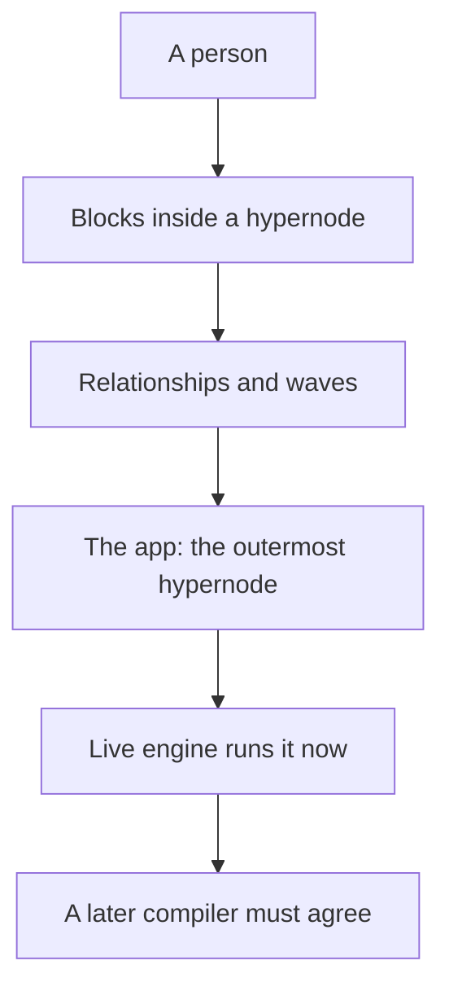
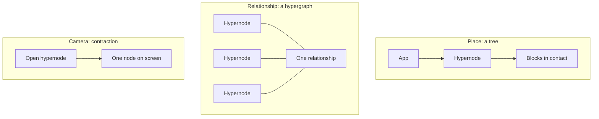
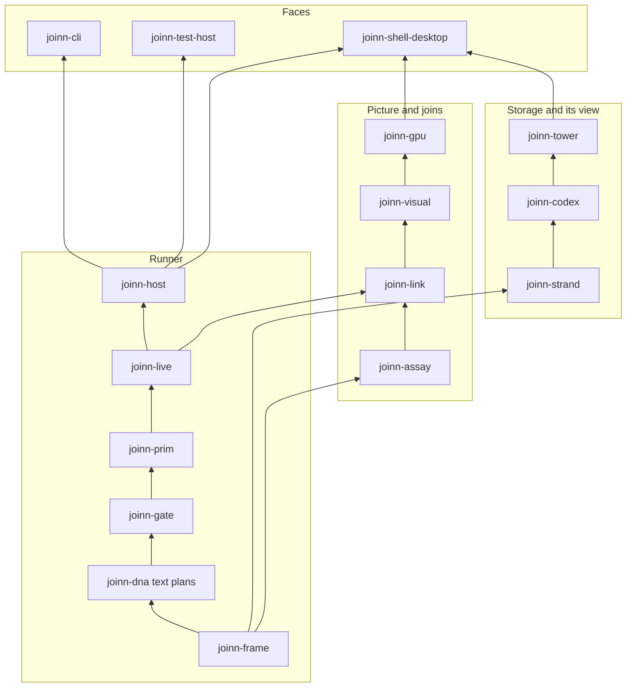
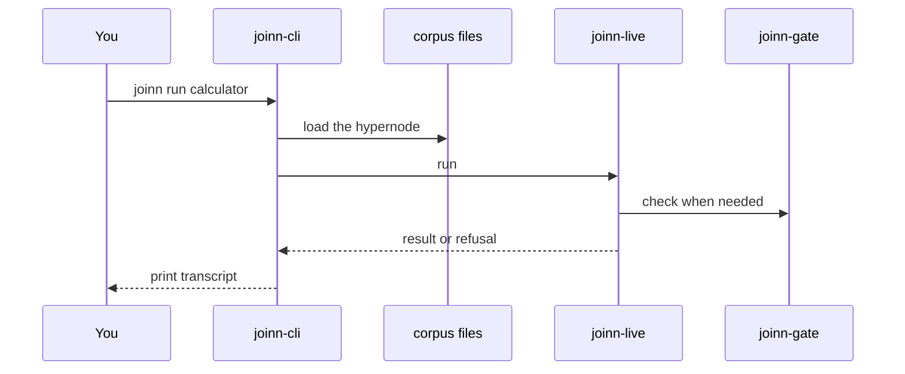
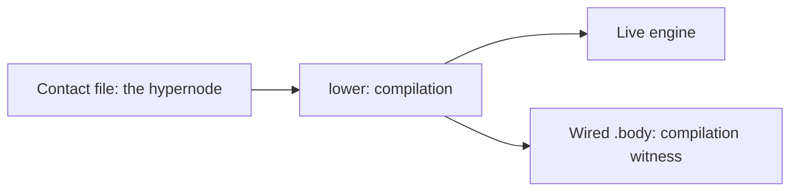
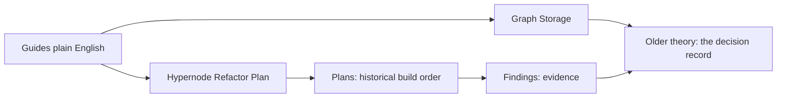

# How the parts connect

> **30 Oct 2026.** The product words are hypernode, relationship, wave, and app. In the code, the contact file is the hypernode the engine runs. The wired `.body` is the witness of `lower`'s compilation, and gate 7 checks that the two match. See [What is JoInn?](01-what-is-joinn.md) and [JoInn Graph Storage](../Theory/JoInn%20Graph%20Storage.md).

This page is the **map**. Each diagram shows how pieces fit. Under the boxes you’ll find **what it is** and **why JoInn needs it**.

If a word is new, peek at the [glossary](05-glossary.md).

---

## 1. Product idea



| Piece | What it is | Why it’s necessary |
|-------|------------|--------------------|
| **A person** | The one who builds | JoInn exists so a person can build an app |
| **Blocks** | The pieces a person snaps. They meet only at their ports | A large app is made of small pieces with clear edges |
| **Hypernode** | Blocks in contact. Edited as blocks, run as one unit, drawn as one node from outside | One shape at every zoom |
| **Relationship** | A join that can touch many hypernodes. A force is a relationship with a direction: it surrounds what it acts on and points at the result | The meaning of contact, stored and drawn |
| **Wave** | A relationship whose members are every part of that hypernode that accepts the signal | One signal, offered to a whole hypernode, with refusal still possible. Building this is [Phase F](../Plans/JoInn%20Hypernode%20Refactor%20Plan.md) |
| **App** | The outermost hypernode | The thing a person ships |
| **Live engine** | The runner that executes a hypernode now, step by step | Answers today, while the compiler is still ahead |
| **Compiler (later)** | A second engine that reads the same form and produces native code | Power, checked against the live engine from the day it exists |

The contact file is the source. The window is a view of that form. Pixels follow the tables.

---

## 2. Place, relationship, and camera

Three different structures. They stay different.



| | What it is | What it may do |
|--|------------|----------------|
| **Place** | Containment. A hypernode holds blocks, and it can hold smaller hypernodes | A tree. A reference to another hypernode is a hash, loaded when asked. A hypernode that contains itself through references is refused |
| **Relationship** | A join that can touch many hypernodes at once | It may cycle. A force is the directed form: it surrounds what it acts on and points at the result |
| **Camera** | Zoom. It draws a hypernode as one node, and a relationship that crosses the boundary is what you still see | Contraction. A folded node is touched once. Today the camera folds three fixed levels: universe, galaxy, system |

A system seen from outside is a hypernode. A galaxy is a zoom depth. The app is the root hypernode.

Today’s code still has cell, body, system, galaxy, and universe as named levels. The [refactor plan](../Plans/JoInn%20Hypernode%20Refactor%20Plan.md) migrates those to depths. The identifiers stay until a phase whose job is the rename. Inside a hypernode you edit by contact. The stored meaning of that contact is a relationship. Zoom draws the hypernode as a node.

---

## 3. Code stack

The code is split into **crates** (separate libraries that depend on each other). Lower layers exist before the upper ones stand.

Arrows in the picture are the main layers, pointing toward the crate that sits above. A few crates also reach sideways. `joinn-host` and `joinn-link` each use the other. The desktop window uses the runner, the picture, and the storage view together.



### What each crate does — and why

| Crate | What it does | Why it’s necessary |
|-------|--------------|--------------------|
| **joinn-frame** | Values, frames (the laws a value obeys), and verdicts: ok, or a refusal | A shared language for “what is a value” and “what is a refusal” |
| **joinn-dna** | The text-plan crate: reads, writes, and hashes today’s plans (cells, bodies, contacts, and the files around them) | Identity needs a precise written form. Letter storage lives in the three crates below |
| **joinn-gate** | Law checks and evolution checks. It can refuse | So “truth first” is a machine |
| **joinn-prim** | The **floor**: sealed opposed operations, and the force register | Higher blocks stand on operations that name their opposites |
| **joinn-live** | Runs a hypernode with an explicit step budget | Answers now. The later compiler has to match this runner |
| **joinn-host** | The host protocol. A description is a value | What was shown can be compared |
| **joinn-cli** | Terminal host: `joinn run calculator` | A face that needs no window |
| **joinn-test-host** | A second, headless host | Two hosts prove a host |
| **joinn-assay** | Measures the shape of a body or universe: loops, and which of them something closes. It reports | A declaration can then refuse an open loop at admission |
| **joinn-link** | Relationships as hyperedges, and `lower`: compilation of a contact hypernode into the deliveries the live engine runs | The source stays a contact file. The runner receives deliveries |
| **joinn-visual** | Tables, the exact camera, and layout in whole numbers | The picture is the tables |
| **joinn-gpu** | Draws those tables | The same owners, on the graphics device |
| **joinn-shell-desktop** | The desktop window | Where a person sees the drawing, the zoom, and the strand |
| **joinn-strand** | Storage: four letters, two bits each, and the partner strand | The alphabet of a stored hypernode |
| **joinn-codex** | Storage: the reader table, and the reader’s own version | Meaning lives in the reader |
| **joinn-tower** | Storage’s view: the Hilbert curve, levels, chromosomes, and the gene pool | The picture of a strand is derived. Layout stays out of the hash |

Nearby helpers (beside the stack):

| Piece | What it does | Why it’s necessary |
|-------|--------------|--------------------|
| **corpus/** | Golden examples, transcripts, and deliberate fakes | The platform keeps replaying what it claimed was true |
| **xtask** | Build instruments (`vocab`, `floor`, `agree`, `gate`, …) | Machines that print numbers. They do not rewrite the story to look green |

---

## 4. One trip through the calculator

The calculator is the first hypernode. Two input blocks meet by contact. One directed relationship, *combine*, points at the result. The window draws that result as its own cell.

What happens when you run the demo:



In words:

1. You ask the CLI to run the calculator.
2. The CLI loads the saved hypernode from **corpus**.
3. The **live** engine runs it. For the contact file, `lower` compiles that source into the deliveries the engine runs.
4. When truth must be judged, the **gate** can **refuse**. The word `"two"` is not an integer.
5. The CLI prints a transcript.

That’s why the expected demo looks like:

```text
a: two
   refused at membrane: "two" is not in ℤ
a: 2
b: 3
   2 + 3 = 5
```

The refusal is a **feature**. The system answers “no” as a value.

The contact source prints the same lines:

```text
cargo run -p joinn-cli -- run corpus/phase7/calculator.contact
```

Step-by-step to run it yourself: [04-try-the-calculator.md](04-try-the-calculator.md).

---

## 5. Source and compilation

The contact file is the source a person would edit. It lists the blocks in contact and the relationships that act on them. `lower`, in joinn-link, compiles that hypernode into the deliveries the live engine runs. The derivation is computed when needed. It is the engine’s compilation of the source.

The wired `.body` is the witness of that compilation: `lower` must produce it byte for byte. Gate 7 shows that the contact calculator lowers to the wired calculator: the same transcript, the same descriptions, and the same surface (`cli_a@0`, `cli_b@0`, `sum@2`). Both files run. Today `joinn run calculator` still runs the wired body; Phase B of the refactor plan makes the contact file the default. A later phase retires the wired file as a second product.



| Piece | What it is | Why it’s necessary |
|-------|------------|--------------------|
| **Contact file** (`.contact`) | The hypernode: blocks that touch, and the forces that act on them | The source says what meets what |
| **Force** | A directed relationship, such as combine on integers. It surrounds its members and points at the response | The operation’s truth lives with the frame it acts on |
| **Force register** | The short table of which frames answer which forces, each with its opposite on file | A registered combine is order-blind: member order is recorded, and the result does not depend on it |
| **`lower`** | Compilation into the deliveries the live engine runs | One runner, fed from the contact source |
| **Wired `.body`** | The compilation witness for today’s calculator | Gate 7 fails if the two forms diverge |

In a **system**, the window draws a force as a lasso: a loop around what it acts on, and an arrowhead at the result. In the **contact calculator** the force still owns no pixel. Drawing that relationship as a lasso on the calculator itself is ahead, in the refactor plan.

A link between bodies, in a universe file, is a relationship the window already draws: one hyperedge, touching its members along the gutters, never crossing a non-member.

---

## 6. How the documentation folders connect



| Folder or paper | Who it’s for | Why it exists |
|-----------------|--------------|---------------|
| **Guides** | Humans who want clarity first | The product, in everyday language |
| **[JoInn Graph Storage](../Theory/JoInn%20Graph%20Storage.md)** | Anyone asking how a hypernode is stored | The storage properties Phase 8 already checked |
| **[Hypernode Refactor Plan](../Plans/JoInn%20Hypernode%20Refactor%20Plan.md)** | The next build, in product words | Phases from this language through to a person building an app |
| **Theory** | The decision record | Laws and vocabulary already settled. Cells, bodies, and forces stay the record for contact and membranes. The DNA paper stays the storage research |
| **Plans** | Ordered construction already written | Each historical phase, left as it was |
| **Findings** | Dated evidence | Hashes, reviews, and what a gate printed |

Code entry: [../../joinn/README.md](../../joinn/README.md). Agent rules: [../../joinn/AGENTS.md](../../joinn/AGENTS.md).

---

## Next

- Progress snapshot: [03-where-we-are.md](03-where-we-are.md)
- Try the demo: [04-try-the-calculator.md](04-try-the-calculator.md)
